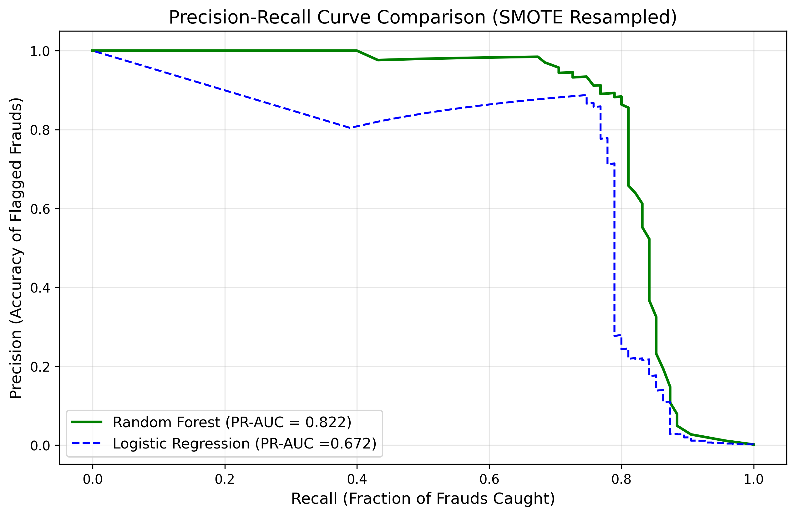

# 💳 Credit Card Fraud Detection (Imbalanced Dataset)

[](https://www.python.org/)
[](https://opensource.org/licenses/MIT)
[](https://imbalanced-learn.org/)
[](https://scikit-learn.org/)

An end-to-end Machine Learning project designed to detect fraudulent credit card transactions from a highly imbalanced dataset using **SMOTE** (*Synthetic Minority Over-sampling Technique*) and **Precision-Recall (PR) Curve Optimization**.

---

## 📌 Problem Overview & The "Accuracy Trap"

Credit card fraud detection is an extreme **binary classification** challenge:
* **Class 0 (Legitimate):** 283,253 transactions (**99.833%**)
* **Class 1 (Fraudulent):** 473 transactions (**0.167%**)

> [!WARNING] The Accuracy Trap
> A naive model that classifies every transaction as "Legitimate" achieves **99.83% accuracy**, yet misses 100% of frauds! In financial fraud detection, **Accuracy is meaningless**. We must evaluate using **PR-AUC**, **Precision**, and **Recall**.

---

## 🏗 Project Architecture

```text
credit_card_fraud_detection/
├── data/
│   └── creditcard.csv      # Raw transaction dataset (excluded from git)
├── models/
│   ├── logistic_regression_pipeline.joblib   # Trained LR pipeline
│   ├── random_forest_pipeline.joblib         # Trained RF pipeline
│   └── precision_recall_curve.png            # Model comparison curve
├── notebooks/
│   └── 01_eda.ipynb        # Exploratory Data Analysis & cleaning
├── src/
│   ├── __init__.py         # Package identifier
│   ├── features.py         # Data loading & duplicate removal
│   ├── train.py            # Stratified split & SMOTE pipeline training
│   └── predict.py          # Model evaluation, PR curve & threshold tuning
├── .gitignore              # Git exclusion rules
├── requirements.txt        # Python library dependencies
├── main.py                 # Master pipeline entry point
└── README.md               # Project documentation
```

---

## ⚙️ Methodology & Pipeline

1. **Exploratory Data Analysis (EDA):**
   * Verified 0 missing values across all 30 features.
   * Identified and dropped **1,081 duplicate transactions**, leaving **283,726 clean rows**.
   * Identified top fraud correlation features: negative (`V17`, `V14`, `V12`, `V10`) and positive (`V11`, `V4`).

2. **Stratified Train-Test Split (80/20):**
   * **Training set:** 226,980 transactions (378 frauds)
   * **Test set:** 56,746 transactions (95 frauds)
   * Stratification ensures the 0.167% fraud ratio is preserved across both splits.

3. **Leakage-Free `imblearn` Pipeline:**
   * **`RobustScaler`**: Scales `Time` and `Amount` handling extreme outliers without distorting PCA components.
   * **`SMOTE`**: Synthetically resamples the minority fraud class **strictly on training data** during `.fit()` to prevent data leakage.
   * **Classifier**: Trains baseline and ensemble classifiers.

4. **Precision-Recall Curve & Threshold Optimization:**
   * Replaced the rigid default threshold (`0.50`) by scanning probabilities to find the optimal decision cutoff maximizing **F1-Score**.

---

## 📊 Experimental Results & Model Comparison

Evaluated on the unseen test set (**56,746 transactions**, 95 actual frauds):

| Model | Pipeline Components | PR-AUC Score | Optimal Threshold | Best F1-Score | Result |
| :--- | :--- | :---: | :---: | :---: | :---: |
| **Logistic Regression** | `RobustScaler` + `SMOTE` + `LR` | 0.6716 | 1.0000 | 0.8114 | Baseline Benchmark |
| **Random Forest** | `RobustScaler` + `SMOTE` + `RF` | **0.8224** | **0.4400** | **0.8398** | 🏆 **Winner (+15.08% PR-AUC)** |

### 📈 Precision-Recall Curve Comparison



> **Key Finding:** By tuning the decision threshold from the default `0.50` to **`0.4400`**, the Random Forest model achieves its peak **F1-Score of 0.8398**, catching more fraudulent transactions while keeping customer false alarms minimal.

---

## 🚀 Quick Start

### 1. Clone the repository
```bash
git clone https://github.com/preethi6379/credit_card_fraud_detection.git
cd credit_card_fraud_detection
```

### 2. Set up virtual environment & install dependencies
```bash
python -m venv venv
# On Windows
.\venv\Scripts\activate
# On Linux/macOS
source venv/bin/activate

pip install -r requirements.txt
```

### 3. Add Dataset
Download `creditcard.csv` from [Kaggle](https://www.kaggle.com/datasets/mlg-ulb/creditcardfraud) and place it in the `data/` folder:
```text
credit_card_fraud_detection/data/creditcard.csv
```

### 4. Run End-to-End Pipeline
```bash
python main.py
```
This single command checks existing models, runs predictions on the test set, evaluates metrics, and generates the comparison curve.

---

## 📋 Completed Milestones

- [x] **Step 0:** Repository architecture & dependency configuration
- [x] **Step 1:** Exploratory Data Analysis & duplicate removal (`notebooks/01_eda.ipynb`)
- [x] **Step 2:** Feature pipeline with `RobustScaler` and `SMOTE` (`src/features.py`)
- [x] **Step 3:** Model training & serialization (`src/train.py`)
- [x] **Step 4:** Model evaluation, PR-AUC scoring & threshold optimization (`src/predict.py`)
- [x] **Step 5:** Unified master execution pipeline (`main.py`)
